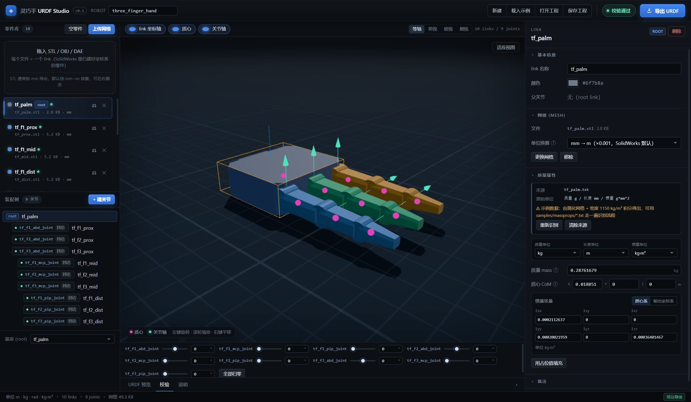
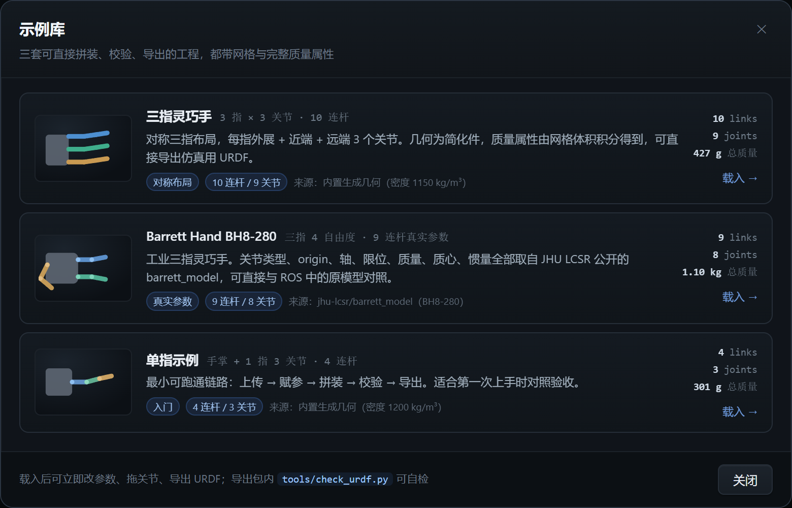

# 灵巧手 URDF Studio

> 分件赋参 → 浏览器里在线拼装 → 一键导出完整 URDF + meshes。
> 给**灵巧手结构工程师**用的纯前端工具，不装 SolidWorks 插件、不读 sldprt、不依赖本地大模型。



内置三套三指手示例，点「载入示例」即可切换：



一句话流程：**CAD 里给每个 link 建好坐标系并拿到质量属性 → 网页里上传网格 + 填参数 → 按关节树拼起来 → 导出 zip（robot.urdf / meshes / README）**。

- 仓库路径：`dexhand-urdf-studio/`
- 技术栈：Vite 5 + React 18 + Three.js 0.169 + JSZip（无后端、无账号）
- 单位：**m / kg / rad / kg·m²**（面板可切 g、mm、g·mm² 等输入单位，存储与导出永远是 SI）

---

## 1. 快速开始

```bash
cd dexhand-urdf-studio
npm install          # 只装了 react / react-dom / three / jszip
npm run samples      # 生成示例网格与质量属性文本（仓库已带，可跳过）
npm run dev          # 打开 http://localhost:5173
```

其他命令：

| 命令 | 作用 |
| --- | --- |
| `npm run build` | 产出 `dist/` 静态站点（`base: './'`，可放任意子目录） |
| `npm run preview` | 本地预览构建产物（端口 4173） |
| `npm run selftest` | 无浏览器的核心逻辑自测（解析 / 惯量 / URDF / 校验 / 打包 / 三个示例，82 项） |
| `npm run verify` | 生成 zip → 解压 → 用 `tools/check_urdf.py` 实测（含坏包反例） |
| `npm run e2e` | 无头 Edge 跑真实交互（需先 `npm run dev`，49 项断言），截图输出到 `shots/` |
| `node scripts/layout-check.mjs` | 布局体检：1920/1680/1440/1366/1280 五档宽度下检查横向溢出与越界 |
| `node scripts/shots.mjs` | 分区截图（顶栏 / 左栏 / 右栏 / 抽屉 / 三个弹窗 / 空态），用于视觉走查 |

> 需要 Node ≥ 18。`npm run dev` 默认监听 localhost；若要局域网访问用 `npm run dev -- --host`。

---

## 2. 演示步骤（对应验收）

1. `npm run dev`，浏览器打开 `http://localhost:5173`。
2. 点顶栏 **载入示例** → 打开 **示例库**，三选一：
   - **三指灵巧手**：3 指 × 3 关节（10 links / 9 joints）
   - **Barrett Hand BH8-280**：9 links / 8 joints，运动学与惯性参数取自公开的 barrett_model
   - **单指示例**：4 links / 3 joints，用于对照验收

   载入后右上显示 *校验通过*，3D 里能看到坐标系、关节轴（青色箭头）、质心小球（品红）。
3. 点左侧 `f1_proximal`：右侧面板显示网格、质量来源（`f1_proximal.txt`、原始单位 g / mm / g·mm²）、换算后的 kg / m / kg·m²。
4. 点零件行的 **⚖** 图标打开「识别质量属性」：把 `samples/massprops/palm.txt` 内容粘进去 → 自动识别为 0.2754 kg、质心 (0.025, 0, 0)、惯量 1.86e-4 kg·m² → 选绑定 link → **应用**。
5. 点装配树的 `f1_joint_mcp`：改 `effort` 7.5、改 `origin` 或 `axis`，下方 **URDF 预览** 与 3D 立即同步；底部滑块可拖动关节看姿态。
6. **+ 建关节**：选 parent / child、类型、origin（默认 0 = 子坐标系与父关节坐标系重合）、axis、limit → 创建（成环会被拒绝）。
7. **导出 URDF**：右侧弹窗确认 zip 结构无错误 → 下载 `dex_hand_demo_urdf.zip`。
8. 解压后校验：

```bash
python3 check_urdf.py robot.urdf     # 纯标准库，不需要 ROS
check_urdf robot.urdf                # 有 ROS/urdfdom 时用官方工具
```

**上传自己的零件**：左栏「上传网格」或直接拖入 `.stl/.obj/.dae`（可多选），每个文件生成一个 link；STL 默认按 **mm→m** 换算（右侧可改 m/cm/in），导出时写进 `<mesh scale>`，不改动原始文件。

---

## 3. 界面说明

整体是深色「精密仪器」风格：近黑中性底 + 发丝级分隔线，蓝色只用于动作（主按钮、选中态），
琥珀色只用于选中物体（3D 里的包围盒），数字统一用等宽字体并开启 tabular-nums，避免跳动。

3D 视口做了这几件事，读图比素色 Three.js 场景更接近 CAD 软件：

- **环境反射**（`RoomEnvironment` + PMREM）+ 三点光：零件表面有柔和的高光渐变，而不是纯色平涂。
- **受光地台 + 实时阴影**：地面用径向 alpha 贴图淡出到背景，阴影相机随模型包围盒自适应，
  零件"落"在地面上而不是飘着；地面高度自动贴合所有网格的最低点。
- **技术网格**用 canvas 生成的径向淡出贴图，避免 GridHelper 边缘硬切。
- 质心球、关节轴箭头按零件尺寸缩放；选中件用低强度自发光 + 琥珀包围盒，不再是整块发蓝。
- 空工程时自动收起地面，只留原点坐标轴 + 一行引导文案。

视口右上角有 **视角预设**（等轴 / 前视 / 俯视 / 侧视）：按当前包围盒重新取景，用于核对坐标系与关节轴方向。

面板侧：零件项把文件名、单位、质量识别状态压到一行（4 个零件在 1366×768 下也能一屏看到），
竖排行（如 joint 的 axis）单独修了标签占位，弹窗统一 13px 圆角 + 分层阴影。
关节多于一屏时（三指手 9 个、双手 20+），底部关节条自动换行并压缩滑块宽度，不会被裁掉。

---

## 4. 功能清单

| 模块 | 已实现 |
| --- | --- |
| 零件入库 | 多文件拖拽上传 STL/OBJ/DAE；每个 link 独立颜色；网格单位换算（m/mm/cm/in）；空零件占位 |
| 参数编辑 | mass、质心 xyz、惯量 6 分量；单位下拉（kg/g、m/mm、kg·m²/kg·mm²/g·mm²）；惯量参考系切换（质心 / 输出坐标系） |
| 质量属性识别 | SolidWorks 质量属性 TXT / CSV / 复制文本（中英文标签）、多文件批量绑定、来源与换算可追溯、缺项高亮、手填兜底 |
| 拼装 | 建关节（parent/child/type/origin/axis/limit）、改父子、改名、删除、root 切换、成环检测 |
| 3D | Three.js 视口、OrbitControls、link 坐标轴、关节轴箭头、质心球、选中高亮+包围盒、关节拖动滑块、适应视图、四档视角预设 |
| 示例库 | 三套工程（单指 / 三指对称 / Barrett BH8-280）一键载入，卡片显示拓扑缩略图、连杆数、关节数、总质量与参数来源 |
| 预览 | 实时 URDF 文本（等宽、可下载）；关节限位按类型输出 |
| 校验 | 20+ 条规则（错误阻断导出 / 警告 / 提示），条目可点击定位到对象 |
| 工程 | 保存/打开 JSON（网格以 base64 内嵌，可单文件搬走）；localStorage 自动保存；Ctrl+S 保存 |
| 导出 | `robot.urdf` + `meshes/` + `params.json` + `check_urdf.py` + `README.md` |

---

## 5. 数据模型

### link（零件）

| 字段 | 含义 | 单位 | 落到 URDF |
| --- | --- | --- | --- |
| `name` | 名称（导出时清洗为 `[A-Za-z0-9_]`） | — | `<link name>` |
| `mesh` | `{fileName, dataBase64, size, unitScale, format}` | — | `<visual><geometry><mesh filename scale>` |
| `mass` | 质量 | kg | `<mass value>` |
| `com` | 质心 xyz（相对 link 原点） | m | `<inertial><origin xyz>` |
| `inertia` | ixx ixy ixz iyy iyz izz（相对所选参考系） | kg·m² | `<inertia>`（导出前统一换算到质心） |
| `inertiaFrame` | `com` / `output` | — | 决定是否做平行轴换算 |
| `placeholder` | 是否占位值 | — | 导出时给警告 |

### joint（关节）

| 字段 | 含义 | 单位 | 落到 URDF |
| --- | --- | --- | --- |
| `name` | 名称 | — | `<joint name>` |
| `type` | `revolute` / `prismatic` / `continuous` / `fixed` | — | `type` |
| `parentId` / `childId` | 连接的两个 link | — | `<parent link>` / `<child link>` |
| `origin.xyz` / `origin.rpy` | child 坐标系在 parent 中的位姿 | m / rad | `<origin xyz rpy>` |
| `axis` | 转轴（在 child 坐标系） | — | `<axis xyz>`（fixed 不输出） |
| `limit` | lower/upper/effort/velocity | rad(m) / N·m / rad·s⁻¹ | `<limit>`（continuous 只输出 effort/velocity） |

`rpy` 采用 URDF 的固定轴 X-Y-Z 外旋（`R = Rz·Ry·Rx`）；面板里可按 **度** 输入。

---

## 6. 从 SolidWorks 应该导出什么

### 6.1 每个 link 一个零件 + 一个网格

1. **建模规范**：每个零件单独一个 `.sldprt`；把**坐标系原点放在关节转轴中心**，并让转轴对齐 X/Y/Z 之一（这样 joint origin 多数填 0）。若沿用装配体坐标系，就把装配体里的 link 坐标系复制进零件。
2. **网格**：`文件 > 另存为 > STL`，选项选 **二进制**、**单位 mm**、偏差 0.05 mm、不勾选「不转换」。本项目默认按 mm→m 换算。
3. **质量属性**：`工具 > 评估 > 质量属性`，把「选项」里的单位设为 **克 / 毫米**，然后
   - 直接 **Ctrl+A 复制窗口文本** → 粘到本工具的「粘贴文本」；或
   - 点「导出」存成 `.txt` / `.csv` → 在「识别质量属性」里多选上传。

### 6.2 建议的参数字段（CSV / JSON）

工具目前支持**逐个零件**导入质量属性（支持一次多文件批量绑定）；若你想先在自己的 Excel 里汇总，建议按下面列名整理（也是后续「批量 CSV 导入」的目标格式，见 backlog）：

`samples/templates/link_params.csv`

```csv
link,mass_kg,com_x,com_y,com_z,ixx,ixy,ixz,iyy,iyz,izz,inertia_frame,mesh_file,mesh_unit
palm,0.2754,0.025,0,0,0.00018646875,0,0,0.00020655,0,0.00035170875,com,palm.stl,mm
f1_proximal,0.011664,0.015,0,0,0.000000629856,0,0,0.000001189728,0,0.000001189728,com,f1_proximal.stl,mm
```

- `mass_kg` / `com_*` / `ixx…izz` 全部 **SI**（kg、m、kg·m²）。
- `inertia_frame` 写 `com` 或 `output`；写 `output` 时导出会自动用平行轴定理换算。
- `mesh_unit` 写 `mm` / `m` / `cm` / `in`，决定 `<mesh scale>`。

对应的 JSON（与工程文件同构）见 `samples/finger_hand.project.json`：`links[]` 每条包含上述字段，`joints[]` 描述关节树。

---

## 7. 质量属性识别（重点）

支持输入：

- SolidWorks「质量属性」窗口的 **TXT / CSV 导出**；
- 从窗口或 **PDF 里复制出来的纯文本**（允许表格错行、制表符、全角标点）；
- 中文版界面（`质量 / 重心 / 惯性力矩`）与英文版（`Mass / Center of mass / Moments of inertia`）；
- 编码：UTF-8 / UTF-16（带 BOM）/ GBK 自动识别。

识别内容与换算：

| 项目 | 说明 |
| --- | --- |
| 质量 | 识别 `g / kg / mg / lb / oz / 克 / 千克…`，统一换成 kg |
| 体积/密度/表面积 | 仅作参考信息，不参与导出 |
| 质心 | 识别 `Center of mass / 重心 / 质心` 下的 X/Y/Z 与长度单位（mm/cm/m/in），换成 m |
| 惯量 | 优先取 **相对质心** 的 `Lxx…Lzz`（`Lzx` 自动映射到 `ixz`）；只有「输出坐标系」时标记 `output` 并在导出时用平行轴定理换算；只有主惯性矩时按对角处理并告警 |
| 单位 | 从 `( grams * square millimeters )` 这类表头识别，`g·mm² → kg·m²` 系数 1e-9 |

界面会显示：**来源文件、原始单位、坐标系假设、换算结果、告警**，并允许逐项改。

识别失败时（例如文本被改乱）：

- 原文完整保留，缺项高亮（`缺 2 项`）；
- 可直接 **「先应用已识别的字段，其余手填」**；
- 每个 link 都有完整手填表单（质量 / 质心 3 项 / 惯量 6 项），可切参考系与单位；
- 一键 **「用占位值填充」**（会打 `placeholder` 标记，导出时给警告，绝不静默填数）。

---

## 8. 导出包与验证

```
dex_hand_demo_urdf.zip
├── robot.urdf          # 4 links / 3 joints
├── meshes/             # palm.stl f1_proximal.stl f1_middle.stl f1_distal.stl（原始字节）
├── params.json         # 参数留档：原始单位/参考系/来源文件
├── check_urdf.py       # 独立校验器（Python 标准库）
└── README.md           # 单位、软件版本、ROS2/MuJoCo/Isaac 加载方法
```

- 网格文件按 `link 名 + 原扩展名` 重命名，避免重名；**字节不变**，缩放靠 `<mesh scale>`。
- 惯量若来自「输出坐标系」，导出时按 `I_C = I_O − m(|d|²E − ddᵀ)` 换算到质心。
- 校验规则（错误会**阻止导出**）：

| 级别 | 规则 |
| --- | --- |
| 错误 | 无 link / 无 root / 多个 root / 成环 / 一个 link 多个父关节 / 悬空 link / 重名 / joint 与 link 重名 / 缺质量 / 惯量全 0 / 惯量非正定 / 缺 axis / revolute·prismatic 缺 limit 或 lower≥upper / effort·velocity ≤0 / parent=child |
| 警告 | 占位值 / 质量或惯量数量级可疑（单位疑似未换算）/ 质心离原点过远 / 惯量不满足三角不等式 / 无网格 / 名字含特殊字符 / prismatic 行程过大 |
| 提示 | mm 网格缩放说明 / fixed 关节 axis 被忽略 |

实测（`npm run verify`）：

```
robot: dex_hand_demo
links: 4, joints: 3, root: palm
OK: 结构与物理参数检查通过

（故意删 limit + 质量置 0）
[ERROR] link palm 的 mass 缺失或 <= 0
[ERROR] joint f1_joint_mcp (revolute) 缺少 <limit>
FAILED: 2 个错误, 0 个警告
```

ROS 2 / MuJoCo / Isaac 的加载命令见导出包里的 `README.md`（`check_urdf`、`robot_state_publisher` + `rviz2`、`mujoco.MjModel.from_xml_path`、Isaac URDF Importer）。

---

## 9. 示例数据包

页面顶栏「载入示例」打开示例库，三套工程都由 `scripts/gen-samples.mjs` 生成，
索引在 `public/samples/index.json`（含连杆数、关节数、总质量、来源）。

### 9.1 Barrett Hand BH8-280（三指，真实参数）

| 项目 | 来源 / 数值 |
| --- | --- |
| 运动学 | `jhu-lcsr/barrett_model` 的 `models/hand.urdf.xacro`（源自 Barrett 官方 SolidWorks 模型） |
| 拓扑 | palm + f1/f2（各 prox→med→dist）+ f3（med→dist），共 9 links / 8 joints |
| 关节限位 | prox 0…180°、med 0…140°、dist 0…48°；effort 5 N·m、velocity 5 rad/s |
| 质量 | palm 0.50573 / prox 0.14109 / med 0.062139 / dist 0.041377 kg（合计 1.0985 kg） |
| 质心与惯量 | 与上游 URDF 逐位一致（含非对角项，如 palm 的 `ixz = -4.2034e-05`） |

**网格是等比简化几何，不是上游 STL**：上游仓库未声明许可证，因此这里按各连杆包围盒
（palm 89×110×90、prox 65 mm、med 78 mm、dist 46 mm）重新生成八棱柱/圆柱近似件，
只用于读图与拼装演示。要换成真实外形，把 SolidWorks 导出的 STL 拖进对应零件行替换即可，
质量属性不会丢。

一处需要说明的细节：原模型 dist 关节的 `rpy=(0,0,45°)`，其网格靠 `<visual><origin rpy="-45°">`
补回姿态。本工具的导出不带 per-link visual offset，所以生成脚本把这 -45° **烘进了网格本身**，
保证导出后 q=0 时远节与中节共线、外观与原模型一致。

### 9.2 三指灵巧手（对称布局）

3 指 × (外展 + 近端 + 远端) = 9 个转动关节，10 links，总质量 0.427 kg。
简化几何，质量/质心/惯量由**网格体积积分**得出（密度 1150 kg/m³），
所以数值和显示的几何自洽，可直接拿来验证「面板数值 = 导出数值」。

### 9.3 单指示例

手掌 + 1 指 3 关节（4 links / 3 joints），方块密度 1200 kg/m³、惯量按长方体解析式计算，
用于对照验收流程。

### 9.4 文件布局

```
public/samples/
├── index.json                    # 示例库索引（页面读取）
├── three_finger.project.json     # 三指灵巧手
├── barrett_bh8.project.json      # Barrett Hand BH8-280
├── finger_hand.project.json      # 单指示例
├── meshes/*.stl                  # 全部网格，单位 mm（模拟 SolidWorks 导出）
└── massprops/*.txt|csv           # 模拟 SolidWorks 质量属性导出（g / mm）
samples/massprops/                # 仓库副本，便于直接拖进识别弹窗
samples/templates/link_params.csv             # 单指示例参数表
samples/templates/link_params_barrett.csv     # Barrett 参数表
samples/templates/link_params_three_finger.csv
```

Barrett 的四个质量属性文本（`bhand_palm.txt` / `f1_prox_link.txt` / `f1_med_link.txt` /
`f1_dist_link.txt`）是真实 CAD 数值按 g / mm / g·mm² 写成的 SolidWorks 报告格式，
可以直接拖进「识别质量属性」验证解析链路：质量 0.50573 kg、质心 (-0.051098, 5.0433, 36.671) mm
这类非整数质心都能原样还原。

---

## 10. 已知限制

1. **不做动力学**：只做零位几何 + 关节拖动姿态预览，无碰撞检测、无自碰撞、无传动/耦合。
2. **不读 SolidWorks 源文件**：必须先在 CAD 里导出 STL 与质量属性；也不支持 STEP/GLB。
3. **PDF 不直接解析**：PDF 请复制文本后粘贴（避免引入 pdf.js 这类重依赖）。
4. **批量 CSV 一表多零件未实现**：当前是「多文件批量绑定」，格式见第 5.2 节（backlog）。
5. **joint origin 不能拖拽对齐**：只能数值输入或用「重合到父级」，没有 transform gizmo。
6. **DAE 贴图不加载**：几何能显示，材质统一用 link 颜色。
7. 关节类型只支持 URDF 四类常用类型，未做 `planar` / `floating`。
8. 网格 > 3.5 MB 时，浏览器自动保存会剥离 base64（防止 localStorage 溢出），请用「保存工程」落盘。
9. 数值导出不用科学计数法：小数位按量级自适应（<1 的数最多 15 位），极小值（<1e-12）写成 0。
10. 大装配（>100 links）没有做实例化渲染优化。

## 11. 下一步建议（backlog）

- **批量 CSV/JSON 导入**：一表多零件 + 一表多关节，导入前做列校验与预览 diff。
- **STEP → 惯量**：接一个可选后端（FreeCAD/OCP 或 trimesh）从 STEP 自动算质量属性，前端只做调用与确认。
- **拖拽对齐**：Three.js TransformControls 让 child 直接拖到父关节，回写 origin。
- **参数化手指模板**：给定节数/尺寸快速生成 link+joint，减少重复劳动。
- **URDF 反向导入**：接手别人的 URDF 进来改，便于迭代。
- **碰撞体简化**：凸包 / 胶囊替代原始网格，减小仿真开销。
- **导出 USD/Isaac 资产**、**mesh 轻量化（Draco/量化）**。
- **质量属性解析增强**：多配置（Configuration 切换）、装配体级质量属性拆分。

---

## 12. 目录结构

```
dexhand-urdf-studio/
├── index.html
├── vite.config.js
├── src/
│   ├── main.jsx
│   ├── App.jsx                 # 状态、布局、上传/保存/导出编排
│   ├── styles.css
│   ├── core/                   # 与 UI 解耦，可在 Node 里单测
│   │   ├── units.js            # 单位表与换算、数值格式化
│   │   ├── parser.js           # SolidWorks 质量属性解析
│   │   ├── inertia.js          # 平行轴换算、正定/三角不等式
│   │   ├── urdf.js             # URDF 文本生成、名称清洗
│   │   ├── validate.js         # 校验规则
│   │   ├── tree.js             # 关节树、成环检测
│   │   ├── project.js          # 数据模型、序列化、base64
│   │   ├── exportZip.js        # zip 打包
│   │   ├── artifacts.js        # 导出包 README + check_urdf.py 源码
│   │   └── fileText.js         # 文本编码识别（UTF-16/GBK）
│   └── components/             # Viewport / 面板 / 弹窗 / 示例库 / 通用控件
├── scripts/
│   ├── gen-samples.mjs         # 生成示例网格与质量属性文本
│   ├── selftest.mjs            # 82 项核心逻辑断言
│   ├── verify-export.mjs       # 导出包 + Python 校验器实测
│   ├── e2e.mjs                 # 无头浏览器交互测试（49 项）
│   ├── shots.mjs               # 分区截图（面板/弹窗）
│   ├── shots-samples.mjs       # 示例库与三指示例截图
│   └── layout-check.mjs        # 五档分辨率溢出体检
├── tools/check_urdf.py         # 独立校验器（也随导出包分发）
├── samples/                    # 示例数据与参数表模板
├── public/samples/             # 供页面 fetch 的示例
└── examples/*.zip              # 三个示例的导出包（可直接解压查看/校验）
```
